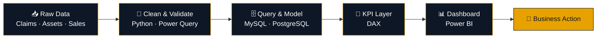

<!-- ============================== HERO ============================== -->

  

 

## 👨‍💻 About

Data Analyst based in **Abu Dhabi** with hands-on experience in **Power BI, SQL, Excel and Python**. I clean, model and report on **IT infrastructure, healthcare, retail and supply chain** data, then build dashboards that show teams **what is changing and where to act**.

**M.Sc. Computer Science**, Bharathidasan University. Open to **Data Analyst · BI Analyst · Power BI Developer · MIS Reporting** roles in the UAE.

<table>
  <tr>
    <td align="center" width="25%"><h2>50,000+</h2>Sales transactions analysed (Rainbow Hypermarket)</td>
    <td align="center" width="25%"><h2>15%</h2>Fewer claim denials via payment discrepancy analysis</td>
    <td align="center" width="25%"><h2>99%</h2>Accuracy on 5,000+ insurance payments (HIPAA compliant)</td>
    <td align="center" width="25%"><h2>6</h2>End-to-end dashboard projects with code</td>
  </tr>
</table>

---

## 🛠️ Tech Stack

           

 

| | |
|---|---|
|  **Power BI** | DAX · Power Query · Data Modeling · Dashboard Development · KPI Reporting · Data Visualization |
|  **SQL** | MySQL · PostgreSQL · Joins · CTEs · Window Functions · Subqueries · Query Optimization |
|  **Advanced Excel** | Pivot Tables · XLOOKUP / VLOOKUP · Power Query · Power Pivot · VBA · Dashboards |
|  **Python** | Pandas · NumPy · Data Cleaning · Exploratory Data Analysis |
|  **Data Analytics** | Data Validation · Data Transformation · ETL · Data Visualization |
|  **Statistics** | Descriptive Statistics · Hypothesis Testing · Correlation Analysis |

---

## ⚙️ How I Work

---

## 🚀 Featured Projects

Each project covers the full path: **raw data → cleaning → query/model layer → dashboard a manager can use.**

<table>
  <tr>
    <td width="50%" valign="top">
      
      <h3>&nbsp; UAE Supply Chain Analytics</h3>
      
Sales, warehouse inventory and supplier performance in a four-page Power BI report, built on Python cleaning and PostgreSQL queries.

      
<b>AED 33.43M</b> revenue &nbsp;·&nbsp; <b>2M</b> units sold &nbsp;·&nbsp; <b>10</b> suppliers

      
      
      
      
        
      <a href="https://github.com/anthony-raj-analytics/UAE-Supply-Chain-Analytics"><b>View repository →</b></a>
    </td>
    <td width="50%" valign="top">
      
      <h3>&nbsp; Blinkit Sales Dashboard</h3>
      
Retail dashboard comparing sales by outlet size, location tier, item type and fat content, with a filter panel and KPI cards.

      
<b>$1.20M</b> total sales &nbsp;·&nbsp; <b>8,523</b> items &nbsp;·&nbsp; <b>3.9</b> avg rating

      
        
      <a href="https://github.com/anthony-raj-analytics/PowerBI-Projects/tree/main/Blinkit-Sales-Dashboard"><b>View repository →</b></a>
    </td>
  </tr>
  <tr>
    <td width="50%" valign="top">
      
      <h3>&nbsp; Healthcare RCM Analytics</h3>
      
End-to-end revenue cycle dashboard showing payment trends, denial patterns and payer performance through DAX-driven KPIs.

      
<b>1,000+</b> claims &nbsp;·&nbsp; <b>54.82%</b> collection rate &nbsp;·&nbsp; <b>DAX</b> KPI layer

      
      
      
        
      <a href="https://github.com/anthony-raj-analytics/Healthcare-RCM-Analytics-PowerBI"><b>View repository →</b></a>
    </td>
    <td width="50%" valign="top">
      
      <h3>&nbsp; IT Infrastructure Analytics</h3>
      
Monitors IT assets, network performance, software licences and security compliance, with DAX measures for licence expiry and monthly infrastructure cost.

      
<b>4</b> report pages &nbsp;·&nbsp; <b>4</b> source tables &nbsp;·&nbsp; <b>DAX</b> KPI layer

      
      
      
      
      
        
      <a href="https://github.com/anthony-raj-analytics/IT-Infrastructure-Dashboard"><b>View repository →</b></a>
    </td>
  </tr>
  <tr>
    <td width="50%" valign="top">
      
      <h3>&nbsp; Rainbow Hypermarket Sales</h3>
      
Sales analytics on a star schema model, with MoM growth, YTD sales, return rate and profit percentage measures.

      
<b>50K+</b> transactions &nbsp;·&nbsp; <b>28</b> DAX measures &nbsp;·&nbsp; <b>Star</b> schema

      
      
      
        
      <a href="https://github.com/anthony-raj-analytics/Rainbow-Hypermarket-PowerBI-2024"><b>View repository →</b></a>
    </td>
    <td width="50%" valign="top">
      
      <h3>&nbsp; Healthcare Claims Data Analysis</h3>
      
Denial patterns and payment trends across claims, cleaned in Power Query, with refresh and reporting automated through VBA.

      
<b>10,000+</b> claims &nbsp;·&nbsp; <b>VBA</b> automation &nbsp;·&nbsp; <b>PQ</b> cleaning

      
      
      
        
      <a href="https://github.com/anthony-raj-analytics/Healthcare-Claims-Data-Analysis"><b>View repository →</b></a>
    </td>
  </tr>
</table>

---

## 💼 Experience

<table>
  <tr>
    <td width="170" valign="top"><b>Aug 2026 – Sep 2026</b></td>
    <td>
      <b>Data Analytics Intern</b> · <i>VDart Academy</i>
      <ul>
        <li>Completed on-the-job training in data analytics using <b>Power BI, SQL, Excel and Power Query</b></li>
        <li>Cleaned, transformed and modeled IT infrastructure datasets for analysis</li>
        <li>Built Power BI dashboards and KPI reports on asset lifecycle, network usage and security compliance</li>
      </ul>
    </td>
  </tr>
  <tr>
    <td valign="top"><b>Jan 2026 – Mar 2026</b></td>
    <td>
      <b>Data Analytics Intern</b> · <i>KGiSL Skillryt</i>
      <ul>
        <li>Developed a <b>5-page interactive Power BI dashboard</b> using Power BI, SQL, Excel and Power Query</li>
        <li>Cleaned, transformed and processed <b>1,000+ records</b> using SQL, Excel and Power Query</li>
        <li>Applied descriptive statistics, data validation and exploratory analysis to find trends and support reporting</li>
      </ul>
    </td>
  </tr>
  <tr>
    <td valign="top"><b>May 2024 – Jun 2025</b></td>
    <td>
      <b>Process Executive, Payment Posting (RCM)</b> · <i>Omega Healthcare</i>
      <ul>
        <li>Processed <b>5,000+ insurance payments with 99% accuracy</b> and HIPAA compliance</li>
        <li>Reduced <b>claim denials by 15%</b> through payment discrepancy analysis</li>
        <li>Maintained 5,000+ payment records and completed daily claims reconciliation at 99% accuracy</li>
      </ul>
    </td>
  </tr>
</table>

---

## 🎓 Education & Certifications

<table>
  <tr>
    <td width="50%" valign="top">

**Education**

- **M.Sc. Computer Science** Bharathidasan University · 2022 – 2024
- **B.Sc. Computer Science** Bharathidasan University · 2019 – 2022

</td>
    <td width="50%" valign="top">

**Certifications** *(click to verify)*

- [**IBM** Data Analyst Professional Certificate](https://coursera.org/share/0a1d60c887908281edd475c92b80e245)
- [**Microsoft** Power BI Data Analyst Professional Certificate](https://coursera.org/share/44ddf95c30567b9332224f593511660a)
- [**Google** Advanced Data Analytics Professional Certificate](https://coursera.org/share/9d29f135cc39c6cb4a73943c44d72a14)
- [**Meta** Data Analyst Professional Certificate](https://coursera.org/share/1e81bc78154ef32393e279a378ed0227)

</td>
  </tr>
</table>

---

## 🤝 Let's Talk About Your Data

Based in **Abu Dhabi**, open to **Data Analyst, BI Analyst, Power BI Developer and MIS Reporting** roles. The quickest way to reach me is email.

