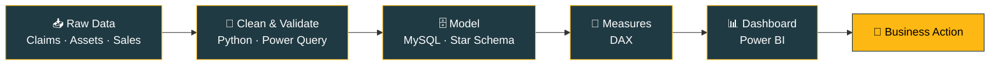

<!-- ===================== HEADER BANNER ===================== -->

 

  

---

## 👨‍💻 About Me

I'm a **Data Analyst** based in Abu Dhabi with hands-on experience in **Power BI, SQL, Excel and Python**, plus a strong background in **Healthcare Revenue Cycle Management (RCM)**. I turn raw claims, payment, IT-asset and retail data into dashboards that show teams **what is changing and where to act**.

- 🏥 At **Omega Healthcare**, processed **5,000+ insurance payments at 99% accuracy** and helped **cut claim denials by 15%**
- 📊 Built dashboards on **50,000+ IT assets** and **50,000+ retail transactions**
- 🎓 **M.Sc. Computer Science**, Bharathidasan University
- 🎯 Targeting roles: **Data Analyst · BI Analyst · Power BI Developer · MIS Reporting** (UAE)

| 50K+ | 99% | 15% | 28 |
|:---:|:---:|:---:|:---:|
| **Assets / Transactions Analyzed** | **Payment Accuracy** | **Claim Denials Reduced** | **DAX Measures Built** |

---

## 🛠️ Tech Stack

### Business Intelligence & Analytics

### Databases & Languages

### Tools

  

<b>📋 Detailed skills breakdown</b>

 

| Category | Tools & Skills |
|---|---|
| **Power BI** | DAX · Power Query · Data Modeling · Star Schema · Dashboard Development |
| **SQL (MySQL)** | Joins · CTEs · Window Functions · Query Optimization |
| **Advanced Excel** | Pivot Tables · XLOOKUP/VLOOKUP · Power Query · Power Pivot · VBA Macros |
| **Python** | Pandas · NumPy · Data Cleaning · Exploratory Data Analysis (EDA) |
| **Data Analytics** | Data Validation · Transformation · Visualization · ETL |
| **Statistics** | Descriptive Statistics · Hypothesis Testing · Correlation Analysis |
| **Domain** | Healthcare RCM · Claims Processing · Denials · Payment Posting · HIPAA Compliance · IT Infrastructure |

---

## ⚙️ How I Work

---

## 🚀 Featured Projects

<table>
  <tr>
    <td width="33%" valign="top">
      <h3>🖥️ IT Infrastructure Analytics</h3>
      
4-page dashboard tracking lifecycle, network and compliance across a large asset base.

      <ul>
        <li>50K+ assets analyzed</li>
        <li>20K non-compliant assets flagged</li>
        <li>$627.78M asset value tracked</li>
      </ul>
      
      
        
      <a href="https://github.com/anthony-raj-analytics/IT-Infrastructure-Dashboard"><b>View Project →</b></a>
    </td>
    <td width="33%" valign="top">
      <h3>🏥 Healthcare RCM Analytics</h3>
      
End-to-end revenue cycle dashboard covering claims, denials and collections.

      <ul>
        <li>1,000+ claims analyzed</li>
        <li>54.82% collection rate</li>
        <li>Denial pattern tracking</li>
      </ul>
      
      
      
        
      <a href="https://github.com/anthony-raj-analytics/Healthcare-RCM-Analytics-PowerBI"><b>View Project →</b></a>
    </td>
    <td width="33%" valign="top">
      <h3>🛒 Rainbow Hypermarket Sales</h3>
      
Retail sales dashboard built on a star schema with time-intelligence measures.

      <ul>
        <li>50,000+ transactions</li>
        <li>28 DAX measures</li>
        <li>MoM, YTD, Return Rate, Profit %</li>
      </ul>
      
      
        
      <a href="https://github.com/anthony-raj-analytics/Rainbow-Hypermarket-PowerBI-2024"><b>View Project →</b></a>
    </td>
  </tr>
</table>

---

## 💼 Experience

<b>📊 Data Analyst Intern — VDart Academy</b> &nbsp;·&nbsp; <i>Aug 2026</i>

 

- Built a **4-page Power BI dashboard** tracking **50,000+ IT assets** across lifecycle, network and compliance
- Modeled **4 datasets in MySQL** and connected them to Power BI using **DAX and Power Query**
- Flagged **20,000 non-compliant assets** and **$1.28M in license spend** for risk and cost review

<b>📈 Data Analyst Intern — KGiSL Skillryt</b> &nbsp;·&nbsp; <i>Jan 2026 – Mar 2026</i>

 

- Developed a **5-page interactive Power BI dashboard** using Power BI, SQL, Excel and Power Query
- Cleaned, transformed and processed **1,000+ records** to support business reporting
- Applied **descriptive statistics** to drive data-informed decisions

<b>🏥 Process Executive, Payment Posting (RCM) — Omega Healthcare</b> &nbsp;·&nbsp; <i>May 2024 – Jun 2025</i>

 

- Processed **5,000+ insurance payments** with **99% accuracy** and full HIPAA compliance
- Reduced **claim denials by 15%** through payment discrepancy analysis
- Maintained 5,000+ payment records and completed daily claims reconciliation

---

## 🎓 Education & Certifications

<table>
  <tr>
    <td valign="top" width="50%">

**🎓 Education**

- **M.Sc. Computer Science** — Bharathidasan University *(2022 – 2024)*
- **B.Sc. Computer Science** — Bharathidasan University *(2019 – 2022)*

    </td>
    <td valign="top" width="50%">

**📜 Certifications**

- IBM Data Analyst Professional Certificate
- Microsoft Power BI Data Analyst Professional Certificate
- Google Advanced Data Analytics Professional Certificate
- Advanced Certification in Data Analytics — Skillryt (KGiSL & NSDC)

    </td>
  </tr>
</table>

---

## 📈 GitHub Stats

---

## 🤝 Let's Connect

I'm actively looking for **Data Analyst, BI Analyst, Power BI Developer and MIS Reporting** opportunities in the **UAE**.

  

